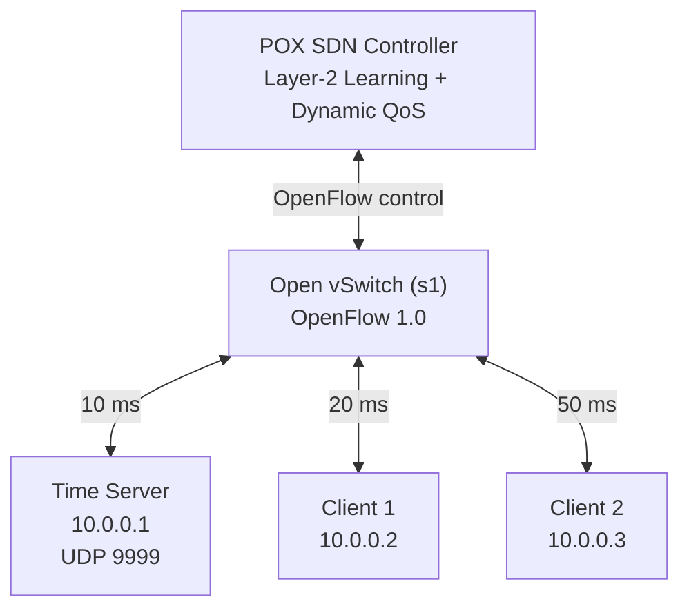

# Network Time Synchronization System (Team 4)

A UDP-based network time synchronization application built with Python sockets, Mininet, Open vSwitch (OVS), and the POX SDN controller.

The system exchanges timestamps between a reference time server and multiple clients. Clients calculate round-trip time (RTT) and estimate clock offset. The Mininet topology introduces controlled link delays, while the POX controller monitors switch traffic and dynamically prioritizes synchronization packets when congestion is detected.

> **Setup and demonstration:** See the [Classroom Demo Guide](docs/DEMO_GUIDE.md) for prerequisites, installation checks, setup instructions, terminal commands, and the complete demonstration sequence.

---

## Team Members

| Name | Student ID |
|---|---|
| Aamir Syed | PES2UG25CS007 |
| Aarush Vishwanath Calamuri | PES2UG25CS011 |
| Abhiveer Verma | PES2UG25CS024 |

## System Architecture

The network contains one reference time server and two synchronization clients connected to a central Open vSwitch. Mininet emulates the hosts and links. POX provides Layer-2 learning and monitors switch-port statistics to control synchronization-traffic prioritization.

### Network topology

### Host and switch-port mapping

| Host | Switch port | IP address | Configured link delay |
|---|---|---|---:|
| Server | `s1-eth1` | `10.0.0.1` | 10 ms |
| Client 1 | `s1-eth2` | `10.0.0.2` | 20 ms |
| Client 2 | `s1-eth3` | `10.0.0.3` | 50 ms |

## Project Features

### 1. UDP time synchronization

The reference server communicates with clients over UDP port `9999`. Each client sends a timestamp request and receives a response containing the client send timestamp and two server timestamps.

### Timestamp calculations

The synchronization process uses four timestamps:

| Timestamp | Description |
|---|---|
| **T1** | Client sends the request |
| **T2** | Server receives the request |
| **T3** | Server sends the response |
| **T4** | Client receives the response |

**Round-trip delay (RTT)**

The client calculates the network round-trip delay using:

$$
\\text{RTT} = (T_4 - T_1) - (T_3 - T_2)
$$

**Clock-offset estimation**

The estimated server-minus-client clock offset is calculated as:

$$
\\text{Offset} = \\frac{(T_2 - T_1) + (T_3 - T_4)}{2}
$$

> **Note:** The application estimates the clock offset but does not modify the host operating system clock.

### 2. Controlled link delays

The Mininet topology uses `TCLink` to configure different delays on the server and client links. This allows the effect of different network conditions on synchronization measurements to be observed.

### 3. Dynamic SDN-based QoS prioritization

The POX controller continuously monitors OpenFlow port statistics and dynamically manages the classification of UDP time-synchronization traffic based on measured traffic rates.

Two QoS queues are attached to each switch port:

| Queue | Purpose |
|---|---|
| Queue 0 | Default queue for ordinary network traffic |
| Queue 1 | High-priority queue for UDP time-synchronization traffic |

Each switch port is configured with a maximum rate of 10 Mbps. Queue creation is handled automatically by `qos_setup.py`, while POX dynamically installs and removes OpenFlow rules to direct synchronization packets to Queue 1.

#### Dynamic decision thresholds

| Setting | Value |
|---|---:|
| Port-statistics polling interval | 1 second |
| Congestion activation threshold | At or above 6 Mbps |
| Activation condition | 2 consecutive samples |
| Congestion-clear threshold | At or below 3.5 Mbps |
| Deactivation condition | 3 consecutive samples |

The difference between the activation and deactivation thresholds introduces **hysteresis**, preventing frequent switching between QoS states when traffic fluctuates. These thresholds are experimental values selected relative to the configured 10 Mbps port bandwidth, not universal networking standards.

#### Controller behaviour

1. POX periodically requests switch-port statistics and calculates traffic rates.
2. When monitored traffic reaches or exceeds 6 Mbps for two consecutive samples, congestion is detected.
3. The controller installs four high-priority OpenFlow rules for UDP synchronization traffic on port `9999`.
4. Matching packets are directed to Queue 1 on the appropriate output port.
5. When monitored traffic remains at or below 3.5 Mbps for three consecutive samples, POX removes the special prioritization rules.
6. Synchronization traffic returns to the default queue.

**Implementation note:** The QoS queues remain configured on Open vSwitch. The controller dynamically manages the OpenFlow rules that determine whether synchronization traffic receives high-priority treatment.

### 4. Automatic QoS queue configuration

The topology invokes the separate QoS configuration component after the Mininet network starts. This creates and attaches the queues to the three switch ports automatically. Queue creation is separate from the dynamic flow-rule decisions made by POX.

### 5. Performance benchmarking

The project includes a benchmark client that sends repeated UDP synchronization requests and records per-sample RTT and estimated clock-offset values. It calculates summary statistics for RTT, including the average, median, minimum, maximum, and 95th percentile, along with the number of successful and failed synchronization requests.

---

## Program files

| File | Description |
|---|---|
| `topology.py` | Creates the Mininet topology, hosts, switch, controller connection, and controlled-delay links. |
| `server.py` | Implements the UDP reference time server. |
| `client.py` | Sends synchronization requests and calculates RTT and clock offset. |
| `qos_setup.py` | Creates and attaches the OVS QoS queues to the switch ports. |
| `dynamic_qos.py` | POX component for traffic monitoring, congestion detection, and dynamic OpenFlow rule management. |
| `benchmark_client.py` | Collects repeated synchronization measurements and writes benchmark CSV files. |
| `client_error_test.py` | Performs one UDP synchronization measurement with a simulated client clock offset and prints the estimated offset, RTT, and absolute synchronization error. |

The repository also includes a [Demo Guide](docs/DEMO_GUIDE.md) with setup, installation checks, execution commands, troubleshooting, and step-by-step demonstration instructions. Experimental datasets, graphs, and validation screenshots are stored in the `results/` directory.

## Experimental results

### Synchronization performance under TCP load

The following results are from one baseline run and one Dynamic QoS run on the original VM. They are observed experimental results, not statistically conclusive averages across repeated trials.

| Metric | Baseline | Dynamic QoS |
|---|---:|---:|
| Successful measurements | 45 / 50 | 50 / 50 |
| Failed measurements | 5 | 0 |
| Average RTT | 1443.379 ms | 32.595 ms |
| Median RTT | 1586.244 ms | 32.295 ms |
| Minimum RTT | 430.050 ms | 31.307 ms |
| Maximum RTT | 2295.442 ms | 38.924 ms |
| 95th percentile RTT | 2171.636 ms | 34.329 ms |

The observed average RTT reduction between these two runs is approximately **97.74%**. The baseline average is calculated over its 45 successful measurements; the five timed-out requests are not assigned an RTT of zero.

### Competing TCP traffic

| Metric | Baseline | Dynamic QoS |
|---|---:|---:|
| Test duration | 90 seconds | 90 seconds |
| Sender throughput | 10.3 Mbps | 10.3 Mbps |
| Receiver throughput | 9.38 Mbps | 9.41 Mbps |
| TCP retransmissions | 1775 | 1833 |

The receiver throughput was nearly identical in both experiments, indicating that the competing TCP traffic was comparable during the two tests. Additional repeated trials are recommended before making a general performance claim.

### Controlled link-delay experiment

For this experiment, Client 1's host-side interface delay was changed from 20 ms to 100 ms. Client 2 remained configured at 50 ms. The table reports averages of the samples collected in each condition.

| Condition | Client 1 delay | Client 1 average RTT | Client 1 samples | Client 2 delay | Client 2 average RTT | Client 2 samples |
|---|---:|---:|---:|---:|---:|---:|
| Baseline | 20 ms | 39.185 ms | 3 | 50 ms | 65.609 ms | 3 |
| Client 1 delay increased | 100 ms | 115.682 ms | 3 | 50 ms | 66.555 ms | 4 |

Increasing Client 1's configured delay increased its average RTT by **76.497 ms**. Client 2's average RTT changed by **0.946 ms**, while its configured delay remained unchanged. Client 1's original 20 ms qdisc configuration was subsequently restored and verified; a post-restoration average RTT was not recorded.

The individual measurements are recorded in [`synchronization_delay_experiment_repeat.csv`](results/synchronization/synchronization_delay_experiment_repeat.csv). Exact RTT values can vary with VM scheduling and network overhead.

### Clock-offset estimation accuracy

The clock-error experiment simulates the client clock as 50 ms ahead of the reference server. Therefore, the expected server-minus-client offset is -50 ms. The test application reports one measurement per execution and does not modify the host operating-system clock.

| Run | Absolute errors across five measurements | Average absolute error |
|---|---|---:|
| Run 1 | 5.330, 5.023, 5.593, 5.182, 5.355 ms | 5.297 ms |
| Run 2 | 6.351, 4.500, 5.696, 4.258, 5.616 ms | 5.284 ms |

The Run 2 measurements are stored in [`clock_offset_accuracy_repeat.csv`](results/synchronization/clock_offset_accuracy_repeat.csv). The earlier results remain in `clock_offset_accuracy.csv`. The [Demo Guide](docs/DEMO_GUIDE.md) explains how to reproduce the five measurements.

## Validation evidence

The `results/validation/` directory contains screenshots captured during project testing:

| Evidence | What it demonstrates |
|---|---|
| `connectivity/mininet_connectivity.png` | Mininet host and switch-port mapping, with `pingall` reporting 0% packet loss. |
| `synchronization/udp_synchronization.png` | Successful timestamp exchange and RTT/offset output from both clients. |
| `dynamic_qos/activation_recovery.png` | POX congestion detection, activation, and automatic return to normal mode. |
| `dynamic_qos/flow_rules.png` | Four high-priority UDP synchronization flow rules. |
| `dynamic_qos/queue1_forwarding.png` | Queue 1 packet counters increasing while synchronization requests and responses are sent during congestion. |

## Limitations

- The client estimates clock offset but does not change the operating system clock.
- The network is emulated in Mininet; results may differ on physical networks.
- The 6 Mbps activation and 3.5 Mbps deactivation thresholds are experimental values selected for the configured 10 Mbps port rate.
- Performance comparisons are based on individual runs; repeated trials are needed for stronger statistical conclusions.
- Execution and measurements can vary with VM CPU scheduling and system load.
- The UDP server currently handles datagrams sequentially in one receive loop. Multiple clients can send requests, but requests are not processed by parallel worker threads.

## References

- [POX SDN Controller repository](https://github.com/noxrepo/pox)
- [POX documentation — installation](https://github.com/noxrepo/pox-doc/blob/master/include/installing.rst)
- [Mininet installation instructions](https://github.com/mininet/mininet/blob/master/INSTALL)
- [Mininet download and setup](https://mininet.org/download/)
